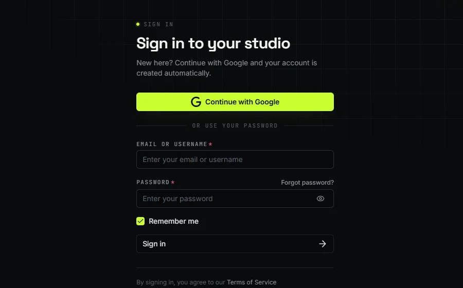
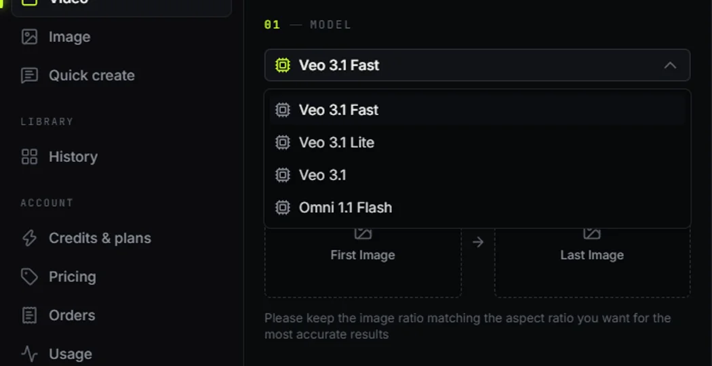
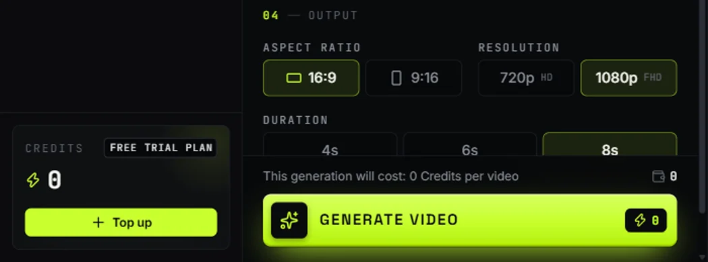
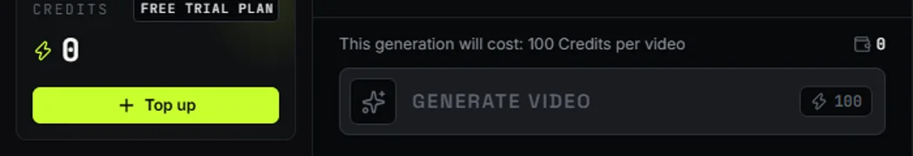
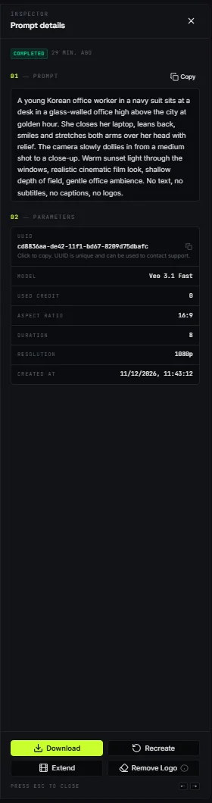

Veo3.1 무료로 쓰는 방법을 찾는 분께 가장 간단한 길은 여러 영상 모델을 한 화면에 모아 둔 스튜디오 **비도그리드(vidogrid.ai)**입니다. 구글 계정으로 로그인한 무료 계정에서 Veo 3.1 Fast와 그록(Grok Imagine) 영상이 0크레딧으로 표시됩니다. 이 글은 2026년 11월 12일 무료 계정 화면에서 확인한 비용 표시와 실제 생성 순서, 그리고 유료 모델로 잘못 넘어가지 않게 확인할 곳을 정리했습니다.

## 결론부터 — Veo3.1 무료로 되는 범위

| 모델 | 해상도 | 길이 | 생성 비용 (2026.11.12 화면 기준) |
|---|---|---|---|
| Veo 3.1 Fast | 720p · 1080p | 4초 · 6초 · 8초 | 0크레딧 |
| Veo 3.1 Lite | 720p · 1080p | 4초 · 6초 · 8초 | 0크레딧 |
| Veo 3.1 (일반) | 1080p | 8초 | 편당 100크레딧 (유료) |
| Grok Imagine Video 1.5 | 480p ~ 1080p | 6초 · 10초 · 15초 | 0크레딧 |

무료 플랜에는 요금 페이지 기준으로 두 가지 제한이 있습니다. 영상은 **한 번에 1개씩**만 만들 수 있고, 영상 길이를 늘리는 **Extend(이어 만들기)는 쓸 수 없습니다**. 무료 범위는 사이트 사정에 따라 바뀔 수 있으므로, 실제로 누르기 전 화면의 비용 표시를 기준으로 삼아야 합니다.

## 비도그리드란 — 영상 AI를 한곳에서 쓰는 스튜디오

보통 영상 AI는 회사마다 사이트가 다르고 가입과 결제도 따로 해야 합니다. 비도그리드는 구글 Veo, xAI 그록, Muse AI 같은 여러 회사 모델을 한 화면에 모아 두고, 위쪽 프로바이더(회사)와 모델 드롭다운만 바꿔 가며 쓰게 만든 스튜디오입니다.

| 항목 | 내용 |
|---|---|
| 주소 | vidogrid.ai (주소창에 직접 입력 권장) |
| 가입 | 구글 계정으로 계속하기 → 계정 자동 생성 |
| 무료 계정 표시 | 오른쪽 위 번개 아이콘 옆 0, FREE TRIAL PLAN |
| 영상 메뉴 | 왼쪽 메뉴 Video → 프로바이더 → 모델 |
| 결과 보관 | History(히스토리)에 저장, 7일이 지나면 자동 삭제 |

이름이 비슷한 사이트나 광고 링크가 검색 결과에 섞여 나올 수 있습니다. 주소를 직접 입력해서 들어가는 편이 안전합니다.

## 가입과 로그인 순서



| 단계 | 할 일 | 확인할 것 |
|---|---|---|
| 1 | 주소창에 vidogrid.ai 입력 | 공식 주소인지 확인 |
| 2 | 오른쪽 위 Log in 클릭 | 로그인 화면이 열림 |
| 3 | Continue with Google 선택 | 처음이면 계정이 자동으로 만들어짐 |
| 4 | 오른쪽 위 번개 0과 FREE TRIAL PLAN 확인 | 크레딧이 0이어도 무료 모델은 생성 가능 |

크레딧이 0으로 보여서 당황하는 경우가 많은데, 무료 모델은 애초에 크레딧을 쓰지 않기 때문에 0이어도 문제가 없습니다.

## 모델 고르기 — 그냥 Veo 3.1은 유료입니다



왼쪽 메뉴에서 Video를 누르고 프로바이더에서 Veo를 고르면 모델 목록이 나옵니다. 여기서 가장 많이 실수하는 부분이 이름이 비슷한 모델입니다.

| 목록에 보이는 이름 | 무료 계정 비용 | 고르는 기준 |
|---|---|---|
| Veo 3.1 Fast | 0크레딧 | 무료로 쓸 때 기본 선택 |
| Veo 3.1 Lite | 0크레딧 | 가벼운 시험용 |
| Veo 3.1 | 100크레딧 | 유료, 무료 계정에서는 고르지 않기 |
| Omni 1.1 Flash | 화면에서 확인 | 비용 표시를 보고 판단 |

그록을 쓰려면 프로바이더에서 Grok을 누르고 Grok Imagine Video 1.5를 고릅니다. 그록 생성 화면에는 xAI 이용 정책 확인 체크박스가 있어서, 체크해야 생성 버튼이 활성화됩니다.

## 프롬프트 쓰는 법 — 네 가지와 no text

결과물 품질은 프롬프트에 무엇이 들어가느냐에 크게 좌우됩니다. 아래 네 가지를 빠짐없이 넣는 것을 추천합니다.

| 요소 | 쓰는 내용 | 예시 |
|---|---|---|
| 누가 | 인물·대상의 생김새 | 남색 정장을 입은 젊은 직장인 |
| 어디서 | 장소·시간·빛 | 노을이 지는 유리벽 사무실 |
| 무엇을 | 동작 한두 개 | 노트북을 덮고 기지개를 켬 |
| 카메라 | 움직임·구도 | 미디엄숏에서 천천히 다가감 |

이 글의 대표 이미지는 아래 프롬프트로 Veo 3.1 Fast에서 만든 영상의 한 장면입니다.

```
A young Korean office worker in a navy suit sits at a desk in a glass-walled office high above the city at golden hour. She closes her laptop, leans back, smiles and stretches both arms over her head with relief. The camera slowly dollies in from a medium shot to a close-up. Warm sunset light through the windows, realistic cinematic film look, shallow depth of field, gentle office ambience. No text, no subtitles, no captions, no logos.
```

프롬프트 끝의 `No text, no subtitles` 문구는 꼭 붙이는 편이 좋습니다. 빠지면 화면 안에 알아볼 수 없는 글자가 깨져서 들어가는 경우가 많습니다. 영어가 어렵다면 한국어로 먼저 쓰고 번역기로 옮겨 붙여도 충분합니다.

그록은 15초까지 만들 수 있어서 구간을 나눠 쓰면 장면 전환이 자연스럽습니다. 0~5초는 뒤에서 따라가기, 5~10초는 옆에서 나란히, 10~15초는 하늘로 올라가는 항공샷처럼 시간대를 적는 방식입니다. 실존 감독이나 애니메이션 스튜디오 이름을 넣으면 그록에서 생성이 막힐 수 있으니 "손그림 느낌의 2D 애니메이션, 수채화 배경"처럼 화풍을 말로 풀어 씁니다.


## 생성 전 확인 — 비용 0 두 군데

가장 중요한 단계입니다. 생성 버튼 바로 위의 비용 문구와 버튼 오른쪽 번개 숫자, **두 곳이 모두 0일 때만** 누릅니다.





| 확인 위치 | 무료일 때 | 유료로 바뀌었을 때 |
|---|---|---|
| 버튼 위 문구 | This generation will cost: 0 Credits | 0이 아닌 숫자 (예: 100 Credits) |
| 버튼 오른쪽 번개 숫자 | 0 | 0이 아닌 숫자 |
| 버튼 색 | 밝은 연두색 (누를 수 있음) | 회색 (크레딧 부족 시) |

모델이나 해상도를 이것저것 바꾸다 보면 어느새 유료 옵션으로 넘어가 있는 경우가 있습니다. 설정을 바꿀 때마다 두 곳을 다시 확인하는 습관을 들이면 됩니다.

## 생성과 다운로드

생성 버튼을 누르면 사람 확인(Cloudflare) 체크가 한 번 나올 수 있습니다. 체크하면 렌더링이 시작되고 진행률이 퍼센트로 올라갑니다. 기다리는 동안 창을 닫아도 결과는 History에 남습니다.



| 상황 | 해결 방법 |
|---|---|
| 생성 버튼이 회색 | 비용이 0이 아닌 모델·설정인지 확인, 그록은 정책 체크박스 확인 |
| 두 번째 영상이 안 만들어짐 | 무료 계정은 한 번에 1개, 앞 영상이 끝난 뒤 생성 |
| 결과물이 사라짐 | History는 7일 뒤 자동 삭제, 바로 다운로드 |
| 화면에 깨진 글자 | 프롬프트 끝에 No text, no subtitles 추가 |
| 길이를 늘리고 싶음 | Extend는 무료 계정에서 쓸 수 없음 |

완성된 영상은 History에서 해당 영상을 열고 상세 정보의 USED CREDIT이 0인지 확인한 뒤 Download로 저장합니다. 같은 설정으로 다시 만들고 싶다면 옆의 Recreate 버튼을 누르면 됩니다.

## 영상으로 보기

이 글의 순서를 1분 세로 영상으로 정리했습니다.

- [네이버 클립에서 1분 영상 보기](https://clip.naver.com/contents?recType=CLIP_PC&recId=%7B%22targetProfileId%22%3A%22qNPyZRggdkwlRClpTBS1%22%2C%22open%22%3Atrue%7D&mediaType=ALL&serviceType=CLIP&seedMediaId=6EF98C78771D096354C80DD15E00CAA2A8AB)

구글 Flow에서 Veo를 쓰는 방법이 궁금하다면 [구글 Veo·Flow 사용법](../google-veo-flow-guide/) 글도 함께 참고하세요.

## 마무리

Veo3.1 무료로 영상을 만들려면 비도그리드에서 Veo 3.1 Fast를 고르고, 생성 전 비용 표시 두 곳이 0인지 확인하는 것이 핵심입니다. 그록은 1080p 15초까지 0크레딧이라 긴 장면을 시험하기에 좋습니다. 무료 조건은 바뀔 수 있으니 이 글의 표보다 실제 화면의 비용 표시를 우선해서 판단하세요. 상업적으로 쓰려는 경우에는 사이트 약관과 각 모델 제공사의 이용 정책을 직접 확인하는 것이 안전합니다.

## 참고 자료

- [VidoGrid 요금 페이지](https://vidogrid.ai/pricing)
- [Google DeepMind Veo 소개](https://deepmind.google/models/veo/)
- [xAI 영상 생성 가이드](https://docs.x.ai/docs/guides/video-generations)
